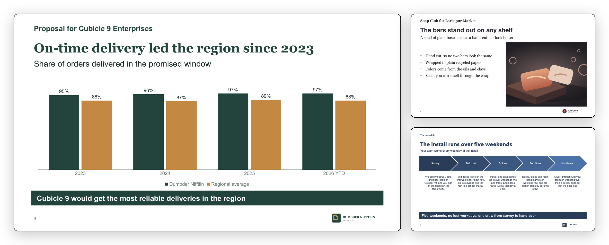
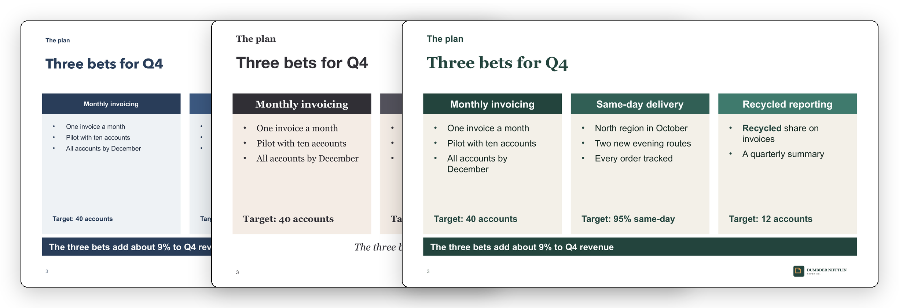

<h1 align="center">deck-builder</h1>

<p align="center">
  Write your slides in markdown or Excel and get back a real, editable PowerPoint deck on your own brand template.
</p>

<p align="center">
  
  
</p>

<p align="center">
  <a href="#install"><b>Install</b></a> &nbsp;|&nbsp;
  <a href="#quick-start"><b>Quick start</b></a> &nbsp;|&nbsp;
  <a href="#write-a-deck"><b>Write a deck</b></a> &nbsp;|&nbsp;
  <a href="#brands"><b>Brands</b></a> &nbsp;|&nbsp;
  <a href="#claude-code"><b>Claude Code</b></a> &nbsp;|&nbsp;
  <a href="#updating"><b>Updating</b></a>
</p>

<br>

<p align="center">
  
</p>
<p align="center"><sub>Slides from one deck in a dark brand kit. The chart is a native PowerPoint chart, and every word is still editable.</sub></p>

<br>

> [!TIP]
> **Using Claude Code?** Just ask: "set up deck-builder", "make a deck from these notes", "fix the fonts in this deck".

You write the content, and deck-builder puts it into your PowerPoint template, so fonts, colors and layout always come from your brand. When something doesn't fit, `check` says what's wrong and how to fix it.

- **Built on your template.** Generate a brand kit from your colors, fonts and logo, or adopt your team's template.
- **Markdown or Excel.** `deck.md` and `deck.xlsx` convert back and forth without losing anything.
- **Native and editable.** Real text, charts, tables, speaker notes and alt text, never a flattened picture.
- **Repeatable.** The same input always builds the same file, and the engine never goes online.
- **Render checks.** Each render measures where every word landed and flags only the slides that need a look.

## Install

You need Python 3.11 or later. Rendering also needs poppler and LibreOffice; `deck-builder doctor` tells you what's missing.

```bash
git clone https://github.com/thefilesareinthecomputer/deck-builder.git && cd deck-builder
uv tool install .                     # deck-builder on your PATH, for you and for Claude Code's agents
deck-builder skills install --yes     # optional: the skills and agents in every Claude Code project
```

`pipx install .` works without [uv](https://docs.astral.sh/uv/). To try it without installing, run `uv run deck-builder ...` in the clone. Use `--editable` if you're working on the engine.

## Quick start

```bash
deck-builder init --dir ~/decks       # a workspace: config, the neutral brand, two example decks
cd ~/decks
deck-builder check workspace/decks/quarterly-review --render
```

This checks, builds and renders the example deck. The `.pptx` goes to `workspace/out/`, with slide images and a contact sheet in `workspace/out/quarterly-review.render/`. Flagged slides get a red border.

## Write a deck

Each `##` heading starts a slide, and `layout:` picks one of the brand's layouts. `key: value` lines fill that layout's fields, `### name` starts a named field (like each card's bullets), and the rest goes into the body:

````markdown
---
brand: dumbder-nifftlin
title: Dumbder Nifftlin Paper Co. Q3 review
kicker: Q3 review
---

## Dumbder Nifftlin Paper Co. Q3 review
layout: title
subtitle: Volume grew in Q3, and Q4 adds three services

## Q4 adds three services
layout: cards-3
kicker: Q4 plan
label1: Monthly invoicing
footer1: "Target: 40 accounts"
label2: Same-day delivery
footer2: "Target: 95% same-day"
label3: Recycled reporting
footer3: "Target: 12 accounts"
takeaway: They add about 9% to Q4 revenue

### body1
- Accounts get one invoice a month
- Every account has it by December

### body2
- The north region starts in October
- Customers track every order

### body3
- Invoices show the **recycled** share
- Accounts get a quarterly summary

## Core-line shipments grew every month in Q3
layout: chart
kicker: Volume
subtitle: September set a record for the core line
takeaway: Specialty held flat, so all the growth came from the core line

```chart
type: column
number_format: '#,##0'
labels: true
categories: [Jul, Aug, Sep]
series:
  - name: Core line
    values: [9800, 10400, 11250]
  - name: Specialty
    values: [3100, 3050, 3120]
```

Notes:
Source: the Q3 shipment ledger.
````

Field values are YAML, so quote any value containing `: `. To try this in the quick-start workspace, change the brand to `neutral`.

The deck holds only content. Change its `brand:` line, or pass `--brand <slug>`, and the same content builds in a different design:

<p align="center">
  
</p>
<p align="center"><sub>The chart slide from the example, built in three brand kits.</sub></p>

Every field has a budget: the most text that fits its box. `deck-builder brand show <slug>` lists them. When a slide goes over budget or names a missing layout or image, `check` reports an issue code, and `deck-builder explain <CODE>` gives the fix.

The format also handles highlighted code blocks, screenshots and photos, one slide per row in `deck.xlsx`, and one deck per row with `build --data rows.csv`. `deck-builder docs deck-md` has the full format.

## Fix up an existing deck

To clean up a deck's fonts, colors and slide numbers, or move it onto your brand, import and rebuild it:

```bash
deck-builder import old.pptx workspace/decks/refresh --brand <slug>
deck-builder check workspace/decks/refresh --render
```

Your original file is never touched. Anything that doesn't fit a layout field, like SmartArt, goes into `import-report.md` and the slide's speaker notes.

## Brands

```
brands/<slug>/
  brand.yaml       # palette, fonts, logos, icons, voice, lint rules, mode and type scale
  assets/          # logos and icons
  template.potx    # generated: masters, layouts, theme
  tokens.yaml      # generated: layouts -> placeholders, budgets, table and chart styling
```

| Starting point | Command |
|---|---|
| Your colors, fonts and logo | `deck-builder brand init <slug> --from brand.yaml` |
| An existing template | `deck-builder brand adopt <slug> --template client.potx`, then a test render tunes the budgets |
| Nothing yet | The `neutral` brand that `init` creates |

Generated kits follow one design standard built on WCAG 2.2 AA, and `brand check` flags low contrast, colorblind-unsafe chart colors and small type. The default `generate.mode: projected` keeps text at 18 pt or more; `read` suits decks read on screen. `deck-builder docs design` has the full rules.

Kits are found through `brand_paths` in `deck-builder.toml`, so they can live in any folder.

## Claude Code

deck-builder ships skills and agents for Claude Code. Describe the deck from a brief or a folder of notes: the agents draft the storyline with you, build the deck and proofread the render before you see it. The brand skill sets up a kit from your colors, fonts and logo.

The agents can't run shell commands. They reach the engine only through its MCP server (`deck-builder mcp`), whose tools stay inside the workspace.

## Commands

`deck-builder --help` lists every command. The ones you'll use most:

| Command | Does |
|---|---|
| `init`, `doctor` | Create a workspace; check what's installed |
| `check <deck> [--render]` | Check a deck; with `--render`, also build, render and measure it |
| `build <deck>` | Build the `.pptx` |
| `convert <in> <out>` | Convert between `.md`, `.xlsx` and `.csv` |
| `import <pptx> <out>` | Turn an existing deck back into `deck.md` |
| `brand list`, `brand show`, `brand init`, `brand adopt` | Find, read and make brand kits |
| `docs [topic]`, `explain <CODE>` | Reference topics and issue-code fixes |

Every command takes `--json`. Exit codes: 0 success, 1 issues to fix, 2 usage or setup problem. [docs/issue-codes.md](docs/issue-codes.md) lists every issue code.

## Principles

- **Content in, design out.** Decks hold text, data and image references. Layout, type and color come only from the brand kit, and budgets are never loosened to make content fit.
- **Confined by default.** A deck reads images only from its own folder, a build writes only its own `.pptx`, and bulk data can't add slides or images. Imported decks are untrusted. The MCP server keeps its tools inside the workspace (and `brand_paths` for brand work) and refuses this clone's `src/`, `.claude/` and `.git/`. An agent's own Write and Edit tools are limited by its instructions, not by code.
- **Restraint.** Slide numbers, footers and status dots use the smallest mark that does the job.

## Updating

The current release is v0.2.0; the [changelog](CHANGELOG.md) lists each release. On each machine:

1. Commit or stash your changes in the clone, then `git pull`.
2. Reinstall: `uv tool install --reinstall .` (add `--editable` for an editable install, or use `pipx install --force .`).
3. If you use the skills in other projects, rerun `deck-builder skills install --yes`, then restart open Claude Code sessions.
4. Run `deck-builder doctor`. It flags an outdated install, unlinked agents and kits made by an older version.
5. Read the release's "Upgrading" notes, then run `deck-builder check` on your decks.

Older brand kits keep working without the new layouts. `deck-builder brand init <slug> --force` upgrades a kit from its `brand.yaml`, replacing tuned budgets and template edits; it backs the kit up to `backups/` first and lists the budgets that changed. To try it on a copy, run `deck-builder brand copy <slug> <slug>-next` first. Upgrades never change adopted kits, and a rebuild won't overwrite a hand-edited `.pptx` without `--force`.

To pin a version: `uv tool install git+https://github.com/thefilesareinthecomputer/deck-builder@v0.2.0`.

## Development

Read [CONTRIBUTING.md](CONTRIBUTING.md) before opening a pull request, and [SECURITY.md](SECURITY.md) to report a vulnerability.

```bash
uv run pytest                          # unit, CLI and scenario tests, plus the render tier when LibreOffice is installed
uv run pytest -m render                # the render tier only
uv run ruff check && uv run mypy
uv run python scripts/readme_images.py # regenerate the images in this README
```

The demo brands in `tests/fixtures/demo-brands/` are the test and showcase brands. Releases follow the [release checklist](docs/release-checklist.md).

## License

Released under the [MIT License](LICENSE).
